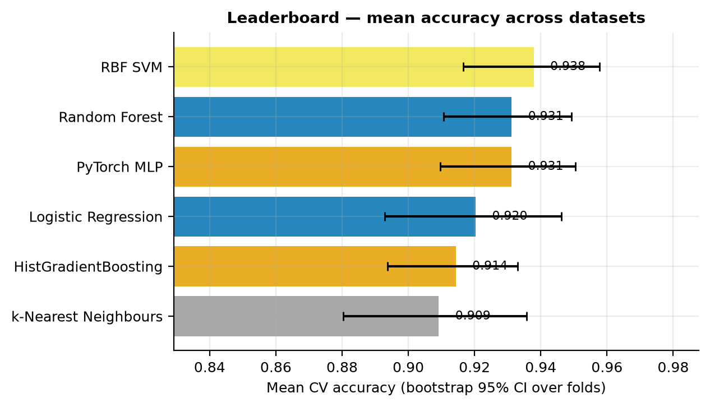
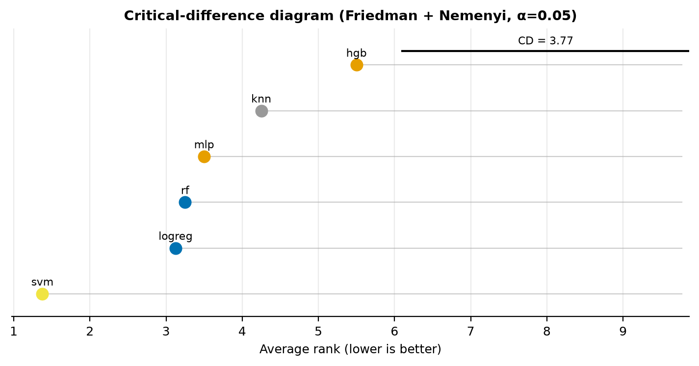
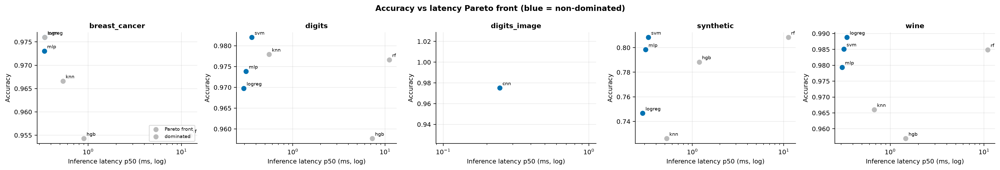
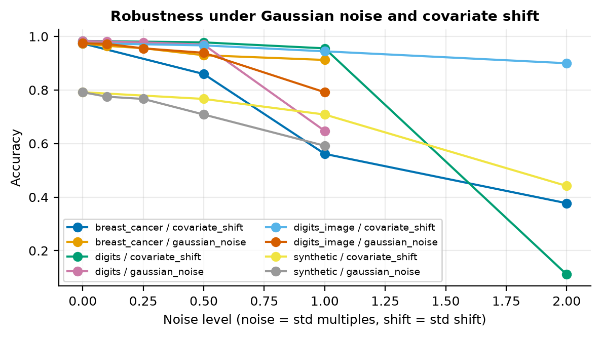
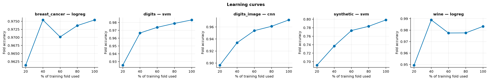
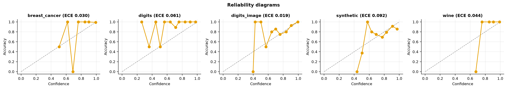
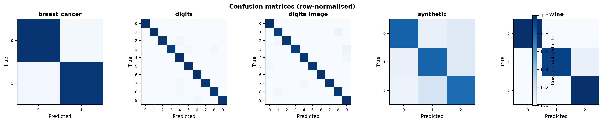
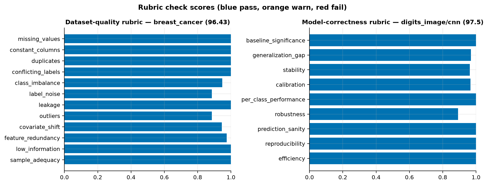
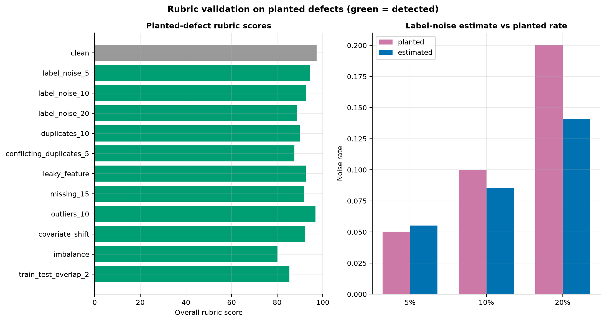
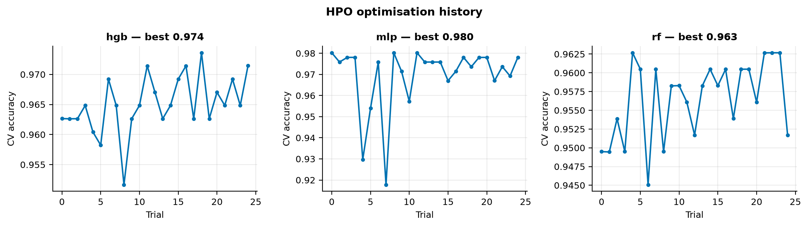

# ml-bench-eval

An ML model benchmarking & evaluation framework: repeated stratified cross-validation over
identical splits, statistical comparison (corrected resampled t-test, Wilcoxon, McNemar,
bootstrap CIs, Friedman/Nemenyi), hyperparameter experiments, systematic error analysis,
and **two hand-written evaluation rubrics** that score dataset quality and model
correctness — all tracked in MLflow, with a static Next.js dashboard whose every number is
exported from real runs.

> **No fabricated results.** Every table and figure below was generated by the commands in
> this README on the machine described under [Results](#results). Each exported JSON records
> its git hash, generation time and source MLflow run IDs. MLflow artifacts stay local;
> only aggregated JSON and figures are committed.

## What is inside

- **Benchmark**: 5 dataset variants (breast cancer, wine, digits tabular, digits 8×8 image,
  synthetic) × up to 7 models (logistic regression, RBF SVM, kNN, random forest,
  HistGradientBoosting, PyTorch MLP, PyTorch CNN), each with repeated stratified CV and full
  computational profiling.
- **Statistics**: Nadeau–Bengio corrected resampled t-test, Wilcoxon signed-rank, exact
  McNemar, paired bootstrap intervals, Holm correction, Friedman + Nemenyi.
- **Generalization**: train/test gap, learning curves, seed sensitivity, robustness to
  Gaussian feature noise and covariate shift.
- **HPO**: Optuna TPE + median pruning with nested MLflow trials and a bias-free tuned-vs-default
  comparison on a held-out split.
- **Error analysis**: confusion structure, per-class metrics, confident errors, error
  clusters, calibration (ECE + reliability bins), slice metrics, markdown findings computed
  from the predictions.
- **Rubrics**: dataset-quality checks (missingness, constants, duplicates, conflicting
  labels, imbalance, confident-learning label noise, leakage, outliers, covariate shift,
  redundancy, low information, sample adequacy) and model-correctness checks (baseline
  significance, gap, stability, calibration, per-class recall, robustness, prediction sanity,
  reproducibility, efficiency), scored 0–100 with a letter grade and per-check severity.
- **Dashboard**: Next.js App Router + TypeScript + Tailwind + Recharts, including a
  **browser-side dataset-quality checker** that is a golden-vector-tested port of the Python
  checks.

## Quick start

Requirements: Python ≥ 3.10, Node ≥ 20, no GPU.

```bash
python3 -m venv .venv
. .venv/bin/activate
pip install -r requirements.txt     # pinned; CPU torch wheel
pip install -e .
pytest -q                           # unit tests + gates
mlbe all --quick                    # < 3 min CI pipeline
```

Full-size run (the numbers in this README):

```bash
mlbe benchmark     # 25 (dataset, model) suites, 5×3 repeated CV
mlbe hpo           # 3 Optuna studies, 25 trials each
mlbe analyze       # error analysis, learning curves, robustness
mlbe rubric        # dataset + model rubrics, planted-defect validation
mlbe repro --sample --demo-failure
mlbe export        # web/public/data/*.json + golden vectors
mlbe figures       # figures/*.png
```

MLflow uses a local SQLite backend (`sqlite:///mlflow.db`) with a local artifact root. To
inspect it: `mlflow ui --backend-store-uri sqlite:///mlflow.db`.

## Architecture

```
configs/            benchmark.yaml · hpo.yaml · rubrics.yaml (all thresholds live here)
src/mlbe/
  config.py seed.py device.py env_info.py metrics.py cli.py
  data/             registry, splits (RepeatedStratifiedKFold), corruptions (planted defects)
  models/           sklearn factories, PyTorch MLP/CNN wrappers, registry
  benchmark/        runner, performance profiling, generalization diagnostics
  stats/            compare (tests), ranking (weights + Pareto)
  hpo/              Optuna search with nested MLflow runs
  analysis/         errors (confusion/calibration/slices/clusters), report (markdown)
  rubrics/          dataset_quality, model_correctness, scoring, report (+validation)
  tracking/         mlflow_utils, queries, repro
  viz/              figure generators
  export/           MLflow → web JSON + golden vectors
tests/              pytest gates for every phase
web/                Next.js static dashboard (deployed on Vercel)
figures/            committed figures (< 5 MB total)
.github/workflows/  CI: lint, tests, quick pipeline, web golden tests + build
```

### Design decisions

- **Splits are shared.** `RepeatedStratifiedKFold` indices are generated once per dataset,
  validated (no overlap, full coverage, stratification) and logged as an artifact with a
  checksum. Every model and every HPO trial reuses the same folds.
- **No leakage in preprocessing.** sklearn models are `Pipeline(StandardScaler, clf)`;
  the PyTorch wrapper fits its scaler on the training fold and an internal 15% split is used
  only for early stopping.
- **CPU-first and deterministic.** Seeds cover Python, NumPy, PyTorch and DataLoader workers;
  CUDA/MPS are used only when present. CPU training with a fixed seed is bit-identical in
  the tests.
- **Selection bias is avoided.** HPO trials are scored by CV inside the 80% training split;
  the 20% test split is touched once for the tuned-vs-default report.

## Statistical protocol

| Test | Where it is used |
|---|---|
| Corrected resampled t-test (Nadeau–Bengio) | pairwise accuracy differences on repeated-CV folds |
| Wilcoxon signed-rank | nonparametric paired check on the same folds |
| Paired bootstrap (2,000 resamples) | confidence intervals for means and differences |
| Holm–Bonferroni | multiple comparisons within a dataset |
| McNemar exact | paired predictions on the shared first test split |
| Friedman + Nemenyi | omnibus ranking consistency across datasets |

Intervals resample folds, not samples, so they describe CV variability rather than a
guarantee on unseen data.

## Rubrics

All thresholds and weights are in [`configs/rubrics.yaml`](configs/rubrics.yaml) and are
exported to the dashboard (`web/public/data/rubric_config.json`). Scores use a documented
piecewise mapping (at the `ok` anchor = 1.00, at `warn` = 0.85, at `fail` = 0.55) and severity
bands: `info ≥ 0.85`, `warn ≥ 0.60`, otherwise `fail`. A category score is the weighted mean
of its checks, the overall score weights dataset quality 0.45 / model correctness 0.55, and
letter grades are A ≥ 90, B ≥ 80, C ≥ 70, D ≥ 60.

### Validation on planted defects

`mlbe rubric` runs the dataset rubric on 11 corrupted datasets built by
`data/corruptions.py`, each with a ground-truth manifest of exactly what was planted. The
table below is generated from that run (seed 42); it is not hand-written.

| Defect | Expected check | Severity | Detected | Label-noise estimate vs planted |
|---|---|---|---|---|
| clean | — | info | — | — |
| label noise 5% | `label_noise` | warn | yes | 0.055 vs 0.05 |
| label noise 10% | `label_noise` | warn | yes | 0.085 vs 0.10 |
| label noise 20% | `label_noise` | fail | yes | 0.141 vs 0.20 |
| duplicates 10% | `duplicates` | fail | yes | — |
| conflicting duplicates 5% | `conflicting_labels` | fail | yes | — |
| leaked feature | `leakage` | fail | yes | — |
| 15% missing values | `missing_values` | fail | yes | — |
| outliers 10% | `outliers` | warn | yes | — |
| covariate-shifted test set | `covariate_shift` | fail | yes | — |
| severe imbalance | `class_imbalance` | fail | yes | — |
| train/test overlap 2% | `leakage` | fail | yes | — |

**Detection: 11/11. Clean dataset: 97.31 (A), no false alarms.**
Noisy-label identification against the manifest: precision **0.85**, recall **0.74**.
Label-noise estimates must land within **±0.05 absolute or 50% of the planted rate,
whichever is larger** (configured as `label_noise_rate_tolerance` and
`label_noise_relative_tolerance`); all three planted rates pass. Under 20% noise the
confident-learning heuristic under-estimates (0.141), which is why the documented tolerance is
not tighter — the limitation is stated rather than hidden.

## Results

Environment recorded in every run and in [`web/public/data/env.json`](web/public/data/env.json):
Linux, Python 3.12.3, 2 logical CPU cores, 3.82 GB RAM, CPU-only, NumPy 2.5.5,
scikit-learn 1.9.1, PyTorch 2.15.0+cpu, MLflow 3.18.0, Optuna 5.1.0. Full benchmark suite:
**280 s**; benchmark → HPO → analysis → rubric took **6.8 minutes** wall-clock (MLflow
run timestamps), and the remaining repro/export/figure steps add under a minute — well inside
the 20-minute budget. `mlbe all --quick` finishes in under 3 minutes.

### Leaderboard (4 tabular datasets, 5×3 CV, seed 42)

Mean accuracy with bootstrap 95% CIs over the 15 folds per dataset, weighted score with
accuracy 0.50 / generalization 0.25 / performance 0.25 (see `stats/ranking.py`).

| # | Model | Mean accuracy | 95% CI | Gap | Latency p50 | Size | Score |
|---|---|---|---|---|---|---|---|
| 1 | RBF SVM | 0.9378 | 0.9165–0.9577 | 0.046 | 0.34 ms | 0.13 MB | 94.9 |
| 2 | PyTorch MLP | 0.9311 | 0.9096–0.9504 | 0.043 | 0.32 ms | 0.03 MB | 94.7 |
| 3 | Logistic Regression | 0.9203 | 0.8929–0.9463 | 0.024 | 0.32 ms | 0.00 MB | 94.7 |
| 4 | k-Nearest Neighbours | 0.9092 | 0.8803–0.9357 | 0.091 | 0.57 ms | 0.23 MB | 91.8 |
| 5 | HistGradientBoosting | 0.9143 | 0.8938–0.9330 | 0.076 | 2.70 ms | 0.55 MB | 88.5 |
| 6 | Random Forest | 0.9312 | 0.9106–0.9494 | 0.069 | 11.41 ms | 2.50 MB | 81.5 |

The CNN is evaluated only on `digits_image` (0.9751, CI 0.971–0.979, 0.24 ms) and is
therefore excluded from the cross-dataset mean.

Best model per dataset (mean CV accuracy):

| Dataset | Best model | Accuracy |
|---|---|---|
| breast_cancer | Logistic Regression / RBF SVM (tie) | 0.9760 |
| digits | RBF SVM | 0.9820 |
| digits_image | PyTorch CNN | 0.9751 |
| synthetic | RBF SVM / Random Forest (tie) | 0.8083 |
| wine | Logistic Regression | 0.9888 |

**Omnibus test.** Friedman χ² = 10.68, p = 0.058, Nemenyi CD = 3.77 over 4 datasets. At
α = 0.05 the omnibus test does *not* reject equal performance, so the rank order is reported
as descriptive; pairwise Holm-corrected tests find 2 significant differences out of 60
pairs (histogram boosting vs SVM on digits; logistic regression vs random forest on
synthetic). McNemar on paired predictions is significant for 5 of 60 pairs.

### Hyperparameter optimisation

3-fold CV inside the 80% training split; 25/25 trials completed; tuned vs default evaluated
once on the 20% hold-out.

| Model | Trials | Best CV | Tuned test | Default test | Δ (test) |
|---|---|---|---|---|---|
| HistGradientBoosting | 25/25 | 0.9736 | 0.9737 | 0.9649 | +0.0088 |
| PyTorch MLP | 25/25 | 0.9802 | 0.9561 | 0.9649 | −0.0088 |
| Random Forest | 25/25 | 0.9627 | 0.9561 | 0.9561 | 0.0000 |

The MLP result is a useful negative: the search maximised CV accuracy, but the tuned model
did not transfer to the hold-out. That is reported rather than tuned away.

### Rubric scores (real datasets)

| Dataset | Dataset quality | Grade | Model correctness (best model) | Grade |
|---|---|---|---|---|
| breast_cancer | 96.43 | A | 96.89 (logreg) | A |
| digits | 88.67 | B | 97.22 (svm) | A |
| digits_image | 88.67 | B | 97.50 (cnn) | A |
| synthetic | 91.98 | A | 81.35 (svm) | B |
| wine | 98.51 | A | 97.32 (logreg) | A |

Overall **93.51 (A)**: dataset quality 92.85, model correctness 94.06.

The digits datasets are legitimately penalised for constant border pixels, class imbalance
and long-tail pixel outliers. The synthetic SVM is penalised for a large generalization gap,
fold instability, calibration and a robustness drop — consistent with its 0.808 accuracy.

### Error analysis highlights

| Dataset / model | Test accuracy | ECE | Weakest class |
|---|---|---|---|
| breast_cancer / logreg | 0.9737 | 0.0298 | class 1, recall 0.972 |
| digits / svm | 0.9833 | 0.0615 | class 3, recall 0.944 |
| digits_image / cnn | 0.9750 | 0.0189 | class 1, recall 0.944 |
| synthetic / svm | 0.7917 | 0.0919 | class 2, recall 0.769 |
| wine / logreg | 0.9722 | 0.0436 | class 1, recall 0.929 |

Full findings, confident-error tables, clusters and slice metrics are in the dashboard and
[`web/public/data/error_analysis.json`](web/public/data/error_analysis.json).

### Reproducibility

`mlbe repro --sample` re-runs a logged fold from its recorded model, dataset, split ID, seed
and subsampling: max |Δ| = 0 across all logged metrics (tolerance 1e-9 sklearn / 1e-5 torch).
The deliberately seed-shifted re-run fails the same check (max |Δ| = 8.3e-05 > 1e-5),
demonstrating the check can detect irreproducibility. Both results are written back onto the
original MLflow run as a tag and metric.

## Figures

Generated from exported JSON, so the figures and the dashboard cannot disagree.

| | |
|---|---|
|  |  |
|  |  |
|  |  |
|  |  |
|  |  |

## Web dashboard

`web/` is a Next.js App Router app (TypeScript, Tailwind, Recharts) with pages for the
overview, leaderboard (live re-weighting + Pareto), statistics (significance matrices,
Friedman/Nemenyi/McNemar), experiments/HPO, error analysis, rubrics (including the
browser-side checker) and the environment/reproducibility record.

```bash
cd web
npm install
npm run test:golden   # TS rubric port vs Python-generated golden vectors
npm run build         # static export
```

Deployment notes:

- The site is fully static (`output: "export"`). Vercel does not run Python, MLflow or
  training. Set **Root Directory = `web`**; `web/vercel.json` then runs `npm ci`,
  `npm run build` and publishes `out`.
- Regenerate the data locally with `mlbe export` (and `mlbe figures`), commit the JSON, and
  redeploy.
- No secrets or `.env` files are needed by the site. `mlruns/`, `mlflow.db`, datasets and
  model binaries are gitignored.

### Browser-side rubric checker

The `/rubrics` page includes a CSV checker that evaluates missingness, constant columns,
duplicates, conflicting labels, imbalance, low-information features, sample adequacy and an
IQR-only outlier heuristic in the browser. Thresholds and scoring formulas are identical to
Python; `web/tests/golden.test.mts` verifies the port against vectors generated by the Python
implementation (`web/tests/golden/rubric_golden.json`). Model-dependent checks (label noise,
leakage, adversarial validation) are not approximated in the browser.

## Reproducibility & determinism

- `seed_everything` sets Python, NumPy, PyTorch (CPU/CUDA), `PYTHONHASHSEED` and deterministic
  kernel flags; DataLoader workers are seeded through `worker_init_fn`.
- Every fold logs its seed, split ID, n_train/n_test, dataset sample count, CV scheme, git
  hash, library versions, CPU/RAM/OS and thread settings as MLflow params/tags.
- Split checksums are asserted equal across models in the tests.
- The sklearn path is exactly reproducible; PyTorch CPU training is bit-identical with a fixed
  seed in the test suite and in the repro check.

## Limitations

- Small, bundled datasets on a 2-vCPU cloud laptop CPU. Absolute accuracies are not claims
  about production data.
- Label-noise detection is a confident-learning-style heuristic validated on planted noise, not
  a ground-truth detector; it under-estimates heavy noise (documented tolerance above).
- Outlier flags include legitimate long tails. The full pipeline requires two of three methods
  (IQR, robust z, Isolation Forest); the browser checker uses wide IQR fences only and labels
  itself accordingly.
- The CNN works on 8×8 digits and is not comparable to full-resolution image benchmarks.
- Intervals resample folds, not samples; Nemenyi is only interpretable when the Friedman
  omnibus test rejects (here p = 0.058, so ranks are descriptive).
- HPO used three models on one dataset; conclusions do not necessarily transfer to other
  datasets.

## License

MIT — see [LICENSE](LICENSE).
